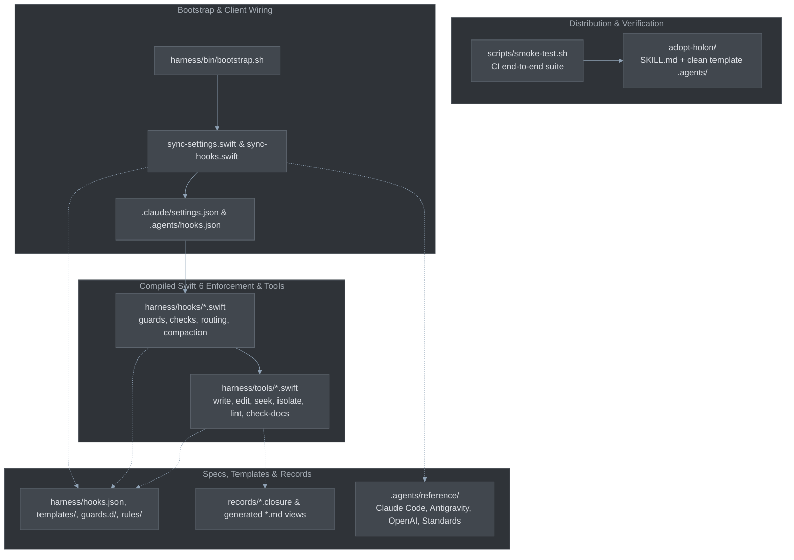

# CODEBASE — HolonStack

> **AGENTS: maintain this file with Haiku or a similar-class model, in grok'd prose.** Style rules: [QUIET](../harness/rules/QUIET.md), [PROSE](../harness/rules/PROSE.md).

The map of the components in HolonStack and the router to the flow docs beside it. When a hook, tool, skill, or bundle boundary changes, update the diagram and the matching layer below in the same change. Add a flow doc → add its row under [Flows](#flows).

## The map

Arrows point from a component to what it calls or generates. Dashed lines are files loaded at run time or kept on disk.

## Layers

1. **Distribution and verification (`adopt-holon/`, `scripts/smoke-test.sh`, `.github/workflows/ci.yml`):** packages the clean `.agents/` template and `/adopt-holon` skill, and tests a full adoption cycle in an isolated temp workspace on macOS and Linux.
2. **Bootstrap and wiring (`harness/bin/bootstrap.sh`, `sync-settings.swift`, `sync-hooks.swift`):** compiles all single-file Swift sources into `.cache/bin/`, generates `bin/` shims and `.claude/skills/` symlinks, and emits `.claude/settings.json` and `.agents/hooks.json` from `harness/hooks.json`.
3. **Runtime hooks (`harness/hooks/*.swift`, `harness/guards.d/*.json`):** thin Swift executables wired to client lifecycle events (`PreToolUse`, `PostToolUse`, `PreInvocation`, `UserPromptSubmit`, `Stop`, `SubagentStop`, `PreCompact`, `PostCompact`, `SessionStart`) that enforce edit, search, bash, subagent-claim, and draft rules.
4. **CLI tools (`harness/tools/*.swift`):** standalone Swift 6 utilities (`write`, `edit`, `seek`, `isolate`, `lint`, `check-docs`, `filter-run`, `perf-*`, `semantics-report`, `transcript-md`) called by agents and hooks.
5. **Templates, records, and upstream references (`harness/templates/`, `records/`, `.agents/reference/`):** declarative closure schemas, validated state with rendered Markdown views, and local upstream platform specs.

## Start here by task

| If you are… | Read | Then edit |
|---|---|---|
| changing hook event wiring or adding a client adapter | [LIFECYCLE.md](LIFECYCLE.md), [reference/README.md](../reference/README.md) | `.agents/harness/hooks.json`, `sync-hooks.swift`, `sync-settings.swift` (and mirror in `adopt-holon/.agents/harness/`) |
| changing a tool guard or post-edit check | [harness-hooks](maps/harness-hooks.md) | `.agents/harness/hooks/guard-*.swift` or `check-*.swift` |
| changing closure parsing, ID minting, or view rendering | [harness-tools](maps/harness-tools.md) | `.agents/harness/tools/write.swift`, `harness/templates/*.closure` |
| changing `edit`, `seek`, `isolate`, or `check-docs` | [harness-tools](maps/harness-tools.md) | `.agents/harness/tools/<tool>.swift` |
| changing the `/adopt-holon` adoption workflow or template | [adopt-holon](maps/adopt-holon.md) | `adopt-holon/SKILL.md`, `adopt-holon/.agents/` |
| adding an end-to-end verification check | [scripts-and-ci](maps/scripts-and-ci.md) | `scripts/smoke-test.sh` |

## Glossary

- **Closure:** a structured record written in nested `()`, `[]`, and `{}` syntax under `.agents/records/`, validated against `harness/templates/<kind>.closure` and written only through `bin/write`.
- **Template:** a `.closure` schema under `harness/templates/` that serves as both the form agents follow and the schema `write.swift` enforces.
- **View:** a generated read-only `.md` file beside the record stores (`MEMORY.md`, `TODO.md`, `OPEN.md`, `BUGS.md`, `AUDIT.md`, `PROPOSALS.md`, `SEMANTICS.md`, `PERF.md`).
- **Semantics card:** a `semantics` closure under `records/SEMANTICS/` injected by `route-semantics.swift` (`scope: always` on every turn, or `scope: routed` on prompt cues and touched paths).
- **Claim:** a target-isolation lease filed via `bin/isolate claim` that binds a parallel subagent to non-overlapping compile inputs and is enforced by `guard-agent.swift` and `guard-edit.swift`.
- **Dogfood root vs. template bundle:** root `.agents/` holds HolonStack's own active maps, references, and records; `adopt-holon/.agents/` holds the clean stubbed template copied into adopting repos.

## Layering rules

1. **Single-file Swift tools and hooks:** every `.swift` under `harness/hooks/` and `harness/tools/` compiles standalone with `swiftc` (Foundation only, no SwiftPM package graph, no Python).
2. **Generated wiring is never hand-edited:** `harness/hooks.json` is the single source of truth; `.claude/settings.json`, `.agents/hooks.json`, `bin/<name>` shims, and `bin/build.sh` are generated by `sync-settings.swift`.
3. **Template records stay clean:** HolonStack's own records go under root `.agents/records/`, never `adopt-holon/.agents/records/` (enforced by `.agents/harness/guards.d/adopt-template-records.json`).
4. **Upstream references stay verbatim:** files under `.agents/reference/<TOPIC>/` are upstream publications and are never edited in place.

## Maps

File-by-file ownership lives in `maps/`: [adopt-holon](maps/adopt-holon.md), [harness-hooks](maps/harness-hooks.md), [harness-tools](maps/harness-tools.md), and [scripts-and-ci](maps/scripts-and-ci.md), each linked in [ATLAS](../ATLAS.md).

## Flows

| File | Open when |
|---|---|
| [LIFECYCLE.md](LIFECYCLE.md) | Following a hook event, a record write, or an `/adopt-holon` bootstrap end to end |

## Theme

Every Mermaid diagram in this folder uses the `%%{init: …}%%` block at the top of [The map](#the-map). Sequence diagrams add `actor*`, `signal*` and `note*` variables to the same palette. Mermaid can't import a shared theme, so copy the block as it is.
