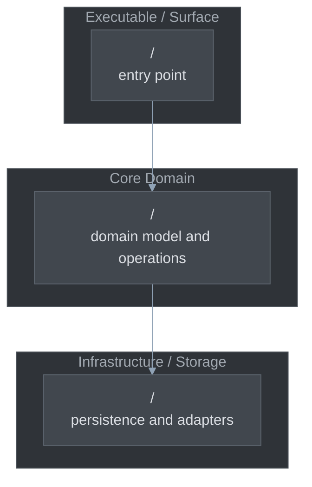

# CODEBASE — <Project Name>

> **AGENTS: maintain this file with Haiku or a similar-class model, in grok'd prose.** Style rules: [QUIET](../harness/rules/QUIET.md), [PROSE](../harness/rules/PROSE.md).

<!-- STUB: Run /adopt-holon to fill this file from the adopting project's build manifests (Package.swift, CMakeLists.txt, meson.build, package.json, Cargo.toml, etc.) and source tree. Use `.agents/harness/bin/isolate graph` (tailored to the build system during /adopt-holon) to inspect targets and dependencies. -->
The map of the packages and targets in this folder and the router to the flow docs beside it. When a target or a dependency changes in the project's build manifests, update the map and the matching layer below in the same change; `bin/isolate graph` prints the targets and dependencies as the manifests declare them. Add a flow doc → add its row under [Flows](#flows).

## The map

<!-- STUB: Replace the placeholder nodes below with the real targets from Package.swift (or project modules). Arrows point from a target to what it uses (direct dependencies only). Dashed lines are things loaded at run time or kept on disk. -->
Arrows point from a target to what it uses. Only direct dependencies from `Package.swift` are drawn: an arrow implied by a longer path is left out. Dashed lines are things loaded at run time or kept on disk.

## Layers

<!-- STUB: Number the architectural layers from top (executables / entry points) to bottom (foundational targets and external dependencies). State what each target owns in one or two sentences. -->
1. **`<ExecutableTarget>/`: the entry point.** Replace with what starts the program or exposes the public API.
2. **`<CoreTarget>/`: the domain.** Replace with the core bounded contexts, domain models and policies.
3. **`<StorageTarget>/`: infrastructure and adapters.** Replace with persistence, transport or low-level primitives.

## Start here by task

<!-- STUB: Map common developer tasks in this project to the flow doc to read first and the exact source files to edit. -->

| If you are… | Read | Then edit |
|---|---|---|
| changing the primary request or command path | [LIFECYCLE.md](LIFECYCLE.md) | `Sources/<Target>/<File>.swift` |
| adding or changing a domain type or rule | [LIFECYCLE.md](LIFECYCLE.md) | `Sources/<CoreTarget>/<File>.swift` |

## Glossary

<!-- STUB: Define the project's ubiquitous language (DDD): domain terms, bounded-context words, and words that mean something specific in this codebase. -->
Define the domain's ubiquitous language here during `/adopt-holon` so every doc, record and comment uses the same terms as the code:

- **`<Term>`:** what it means in this codebase and which type represents it.

## Layering rules

<!-- STUB: List the dependency and boundary rules that must always hold across targets (e.g., which targets must remain leaf or foundation targets, how cross-boundary calls work). -->
`Package.swift` decides the dependencies; the map above is drawn from it.

1. **`<CoreTarget>` is independent of upper layers** and imports nothing from `<ExecutableTarget>`.
2. **State the next architectural boundary rule here** after inspecting `bin/isolate graph`.

## Maps

The file-by-file detail, which file owns what, is in [maps/](maps/module-template.md): one map per layer or target above, each listed in [ATLAS](../ATLAS.md) under "Maps". This page stays at the level of targets.

## Flows

| File | Open when |
|---|---|
| [LIFECYCLE.md](LIFECYCLE.md) | Following an operation end to end from entry point through domain logic to output or persistence |

## Theme

Every Mermaid diagram in this folder uses the `%%{init: …}%%` block at the top of [The map](#the-map). Sequence diagrams add `actor*`, `signal*` and `note*` variables to the same palette. Mermaid can't import a shared theme, so copy the block as it is.
