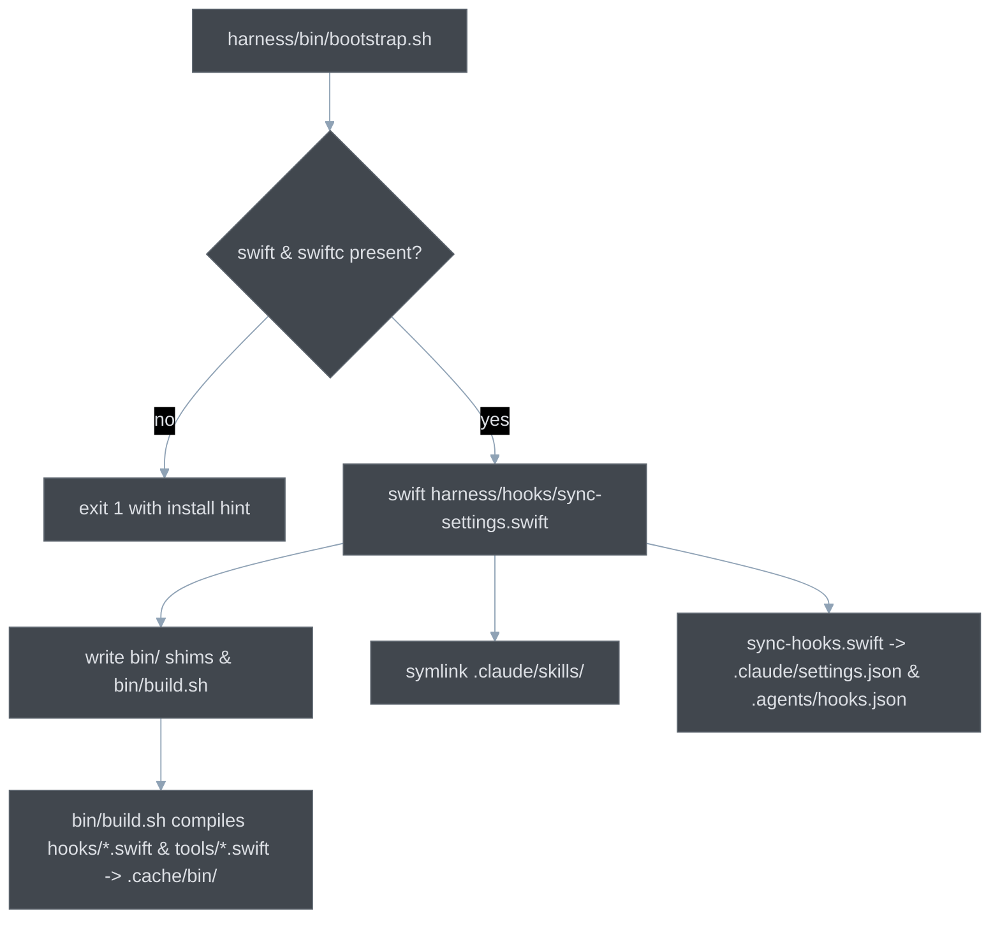

# LIFECYCLE — hook dispatch, record writes, and adoption

> **AGENTS: maintain this file with Haiku or a similar-class model, in grok'd prose.** Style rules: [QUIET](../harness/rules/QUIET.md), [PROSE](../harness/rules/PROSE.md).

What happens from the moment an agent client fires a tool call or prompt event until the harness allows, blocks, checks, or records the result.

The component map is in [CODEBASE.md](CODEBASE.md). **Update this file when** a hook event, exit-code contract, sync target, or adoption step changes.

## Primary tool-call hook flow

```mermaid
%%{init: {"theme":"base","themeVariables":{"darkMode":true,"background":"#363B40","primaryColor":"#41474E","primaryTextColor":"#DCDFE4","primaryBorderColor":"#5C646D","lineColor":"#8FA2B5","textColor":"#B8BFC6","actorBkg":"#41474E","actorBorder":"#5C646D","actorTextColor":"#DCDFE4","signalColor":"#8FA2B5","signalTextColor":"#B8BFC6","noteBkgColor":"#2B3F52","noteTextColor":"#DCDFE4","noteBorderColor":"#5B8DB8"}}}%%
sequenceDiagram
    participant Client as Claude Code / Antigravity
    participant Pre as PreToolUse Hook (bin/guard-*)
    participant Tool as bin/edit or bin/write
    participant Post as PostToolUse Hook (bin/check-*)

    Client->>Pre: JSON payload on stdin (tool_name, tool_input, agent_id)
    alt blocked (exit 2)
        Pre-->>Client: stderr reason; tool call refused
    else allowed (exit 0)
        Pre-->>Client: pass (or rewritten command from rewrite-bash)
        Client->>Tool: execute command or tool
        Tool-->>Client: diff / JSON result / exit code
        Client->>Post: JSON payload on stdin
        Post->>Post: lint Swift, check drafts/wiring, route semantics
        Post-->>Client: additionalContext / stderr diagnostics
    end
```

## Bootstrap and sync flow



## Entry points

| What | Defined in |
|---|---|
| Bootstrap & compilation | `.agents/harness/bin/bootstrap.sh` |
| Client hook & shim generation | `.agents/harness/hooks/sync-settings.swift`, `.agents/harness/hooks/sync-hooks.swift` |
| Tool guards (`PreToolUse`) | `.agents/harness/hooks/guard-edit.swift`, `guard-bash.swift`, `guard-search.swift`, `guard-agent.swift`, `rewrite-bash.swift` |
| Post-edit & stop checks | `.agents/harness/hooks/check-edit.swift`, `check-shell-edit.swift`, `check-drafts.swift` |
| Semantics routing & compaction | `.agents/harness/hooks/route-semantics.swift`, `pre-compact.swift`, `post-compact.swift`, `session-compact.swift` |
| Closure validation & view rendering | `.agents/harness/tools/write.swift` |
| End-to-end verification | `scripts/smoke-test.sh` |

## Invariants and gotchas

- **Exit code 2 blocks; exit code 0 allows:** all `PreToolUse` and `Stop` hooks follow the Claude Code / Antigravity blocking-error exit contract (documented in `.agents/reference/CLAUDE_CODE/hooks.md` and `.agents/reference/ANTIGRAVITY/hooks.md`).
- **Cached binaries must be rebuilt after editing `.swift`:** `bin/<name>` executes `.cache/bin/<name>`; editing a hook or tool requires running `.agents/harness/bin/lint` and `.agents/harness/bin/build.sh`.
- **Two copies of the harness exist in this repo:** root `.agents/harness/` runs on HolonStack itself, and `adopt-holon/.agents/harness/` is what ships to adopters. Port shared harness fixes to both, while keeping root-only rules (like `guards.d/adopt-template-records.json`) out of `adopt-holon/`.
- **`sync-settings --check` detects wiring drift:** changing `harness/hooks.json` or adding a hook/tool/skill without running `sync-settings` fails `check-edit` and CI.
