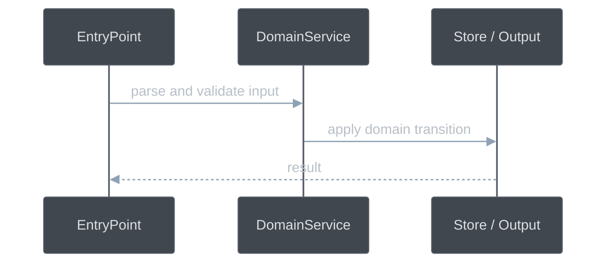
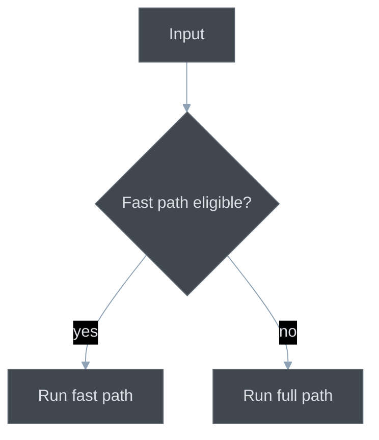

# LIFECYCLE — one operation, end to end

> **AGENTS: maintain this file with Haiku or a similar-class model, in grok'd prose.** Style rules: [QUIET](../harness/rules/QUIET.md), [PROSE](../harness/rules/PROSE.md).

<!-- STUB: Run /adopt-holon to trace the primary end-to-end lifecycle of the adopting project (e.g. a request, a command, a compilation pass, an event pipeline, or a transaction). -->
What happens from the moment an input enters the system until the output or state change completes.

The module map is in [CODEBASE.md](CODEBASE.md). **Update this file when** a step is added or reordered in the primary execution path, a dispatch or resolution rule changes, or a boundary hand-off changes.

## Primary turn or request flow

<!-- STUB: Replace the participants and messages below with the actual types and calls traced from the codebase. -->

## Decision and dispatch flow

<!-- STUB: Add flowcharts for key branching decisions (e.g. fast path vs fallback, caching, routing, error recovery). -->

## Entry points

<!-- STUB: Map each stage of the lifecycle to the exact file and function that defines it. -->

| What | Defined in |
|---|---|
| Startup / main entry point | `Sources/<Target>/<File>.swift` |
| Primary dispatch / execution | `Sources/<Target>/<File>.swift` |

## Invariants and gotchas

<!-- STUB: List the rules that must always hold across this lifecycle and non-obvious traps in the code. -->
- State the rules that must always hold across the lifecycle after tracing the source in `/adopt-holon`.
