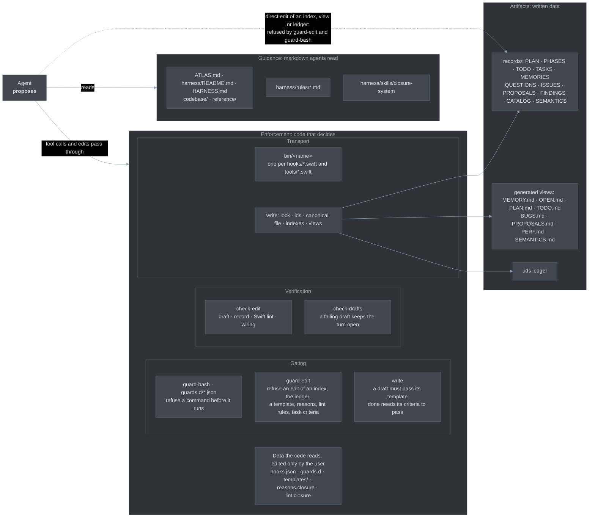
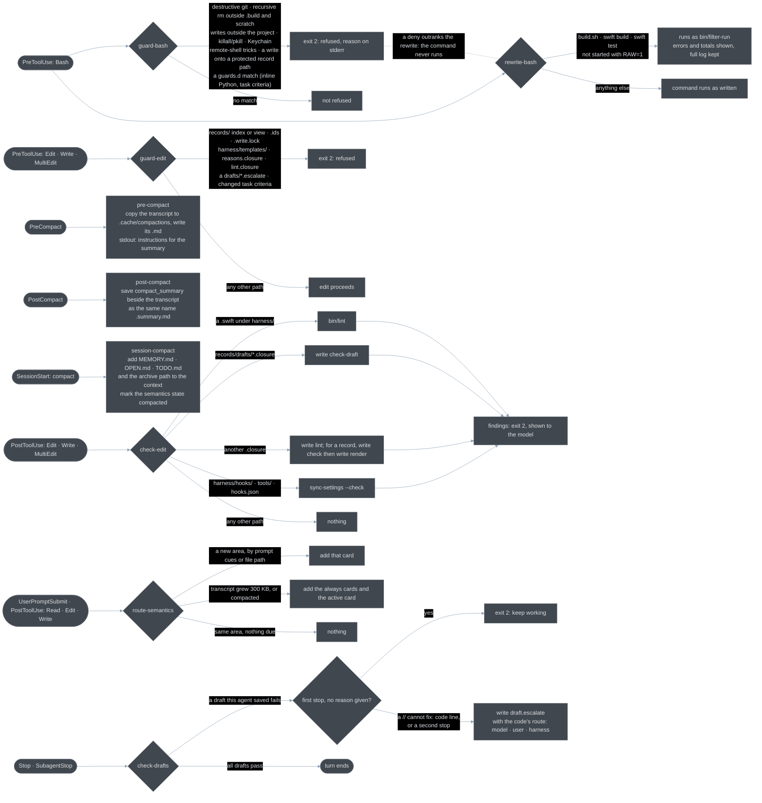
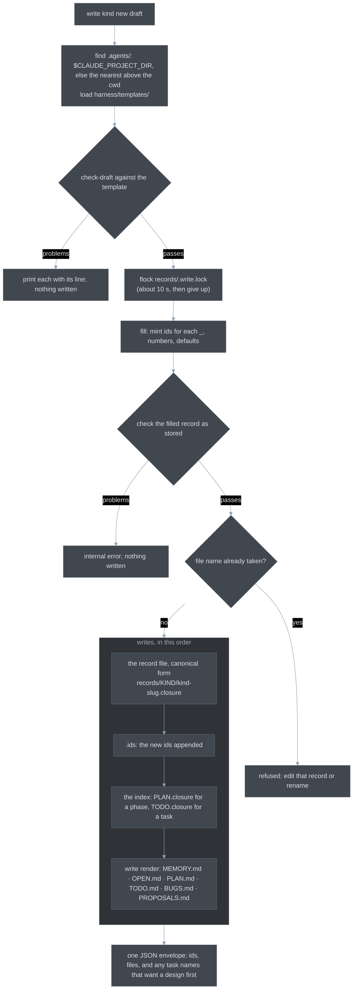

# HARNESS — the `.agents/` system as diagrams

> **AGENTS: maintain this file with Haiku or a similar-class model, in grok'd prose.** Style rules: [QUIET](rules/QUIET.md), [PROSE](rules/PROSE.md).

Three diagrams:
1. what enforces and what only advises;
2. what runs on each hook event;
3. what one record write does.

The prose for each part is in [README.md](README.md), and the rules agents follow are in [rules/](rules/). **Update this file when** `hooks.json`, a hook's branches, or `write`'s `new` or `done` path changes.

## 1. Enforcement, guidance and artifacts

A part is enforcement only if it still holds against an agent that ignores the guidance. That means code that runs outside the model and decides whether an action happens. A markdown rule is guidance. A record, once written, is an artifact.

- **Gating:**
  - `guard-bash` and `guards.d/*.json` refuse a command before it runs.
  - `guard-edit` refuses an edit of an index, the ledger, a template, `reasons.closure`, `lint.closure` or an escalation. It also refuses a change to a filed task's criteria.
  - `write` refuses a draft that fails its template, and a `done` whose criteria fail.
- **Verification:**
  - `check-edit` checks each save: a draft against its template, a record against its template and canonical form (then it renders the views), Swift under `harness/` against the lint rules, and the hook wiring.
  - `check-drafts` keeps a turn open while a draft fails.
- **Transport:** the generated `bin/` entry points, and `write`'s file writes under its lock.
- **Guidance:** `ATLAS.md`, the rules, the README and this file, the skills, and the docs under `codebase/` and `reference/`.
- **Artifacts:** the record stores, their generated views and the `.ids` ledger.

## 2. What runs on a hook event

`hooks.json` binds ten events, two hooks on Bash and two after an edit, and `sync-settings` writes them into `.claude/settings.json`. Each hook reads the event's JSON on stdin and exits 2 to refuse, or to show the model what it found. Nothing here commits. The three compaction hooks never refuse: `pre-compact` gives Claude Code instructions for the summary on stdout, and they archive the transcript and the summary and put the record views back into the context after a compaction ([rules/COMPACT.md](rules/COMPACT.md)). `route-semantics` never refuses either: it adds an area's semantics card to the context.

## 3. One record write

`bin/write` runs [tools/write.swift](tools/write.swift) as a cached binary and falls back to `swift`. Commands that only read take no lock: `list`, `get`, `check`, `check-draft`, `next`, `show` and `measure`. The diagram follows `new`; `done` is described below it.

**`done <task>`** runs each criterion's `check:` from the project folder and prints `pass`, `confirmed` or `FAIL` for each.
- **If any fails,** the task stays open.
- **If all pass,** it takes the lock, sets `done: true`, checks the record, writes it, renders the views, and prints the evidence.
- **It commits nothing,** and there is no lint gate on the project's `Sources/`.

`reopen` sets `done: false` without running anything.

## Where each part is described

| Part | File |
|---|---|
| Layers, guards, tools, what is not built | [README.md](README.md) |
| Record kinds, ids, drafts, criteria, the done gate | [rules/RECORDS.md](rules/RECORDS.md) |
| The notation and the placeholders | [rules/NOTATION.md](rules/NOTATION.md) |
| Escalation routes | [rules/ESCALATION.md](rules/ESCALATION.md) |
| Hook events and their scripts | [hooks.json](hooks.json), [hooks/](hooks/) |
