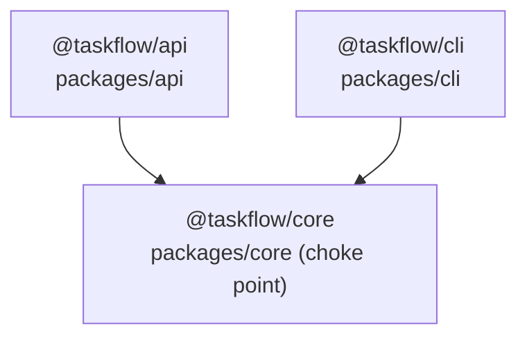

# CODEBASE — TaskFlow

> **AGENTS: maintain this file with Haiku or a similar-class model, in grok'd prose.** Style rules: [QUIET](../harness/rules/QUIET.md), [PROSE](../harness/rules/PROSE.md).

TaskFlow is a three-package pnpm workspace. `@taskflow/core` owns the task model and in-memory store; `@taskflow/api` and `@taskflow/cli` are independent consumers that depend only on `@taskflow/core`.

## Module graph

## Task-to-code table

| Task | Package | Entry point |
|---|---|---|
| Change `Task` fields or `TaskStore` rules | `@taskflow/core` | `packages/core/src/task.ts` |
| Change JSON payload validation or HTTP create handler | `@taskflow/api` | `packages/api/src/server.ts` |
| Change CLI argument parsing or output formatting | `@taskflow/cli` | `packages/cli/src/main.ts` |

## Layering rules

- `@taskflow/core` imports nothing from `@taskflow/api` or `@taskflow/cli`.
- `@taskflow/api` and `@taskflow/cli` never import each other; parallel workers can edit both at once under `isolate`.
